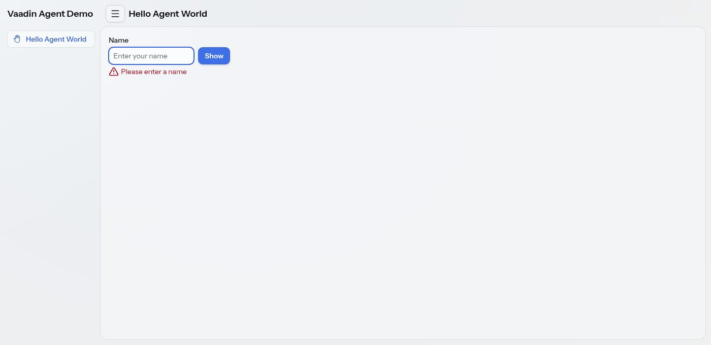
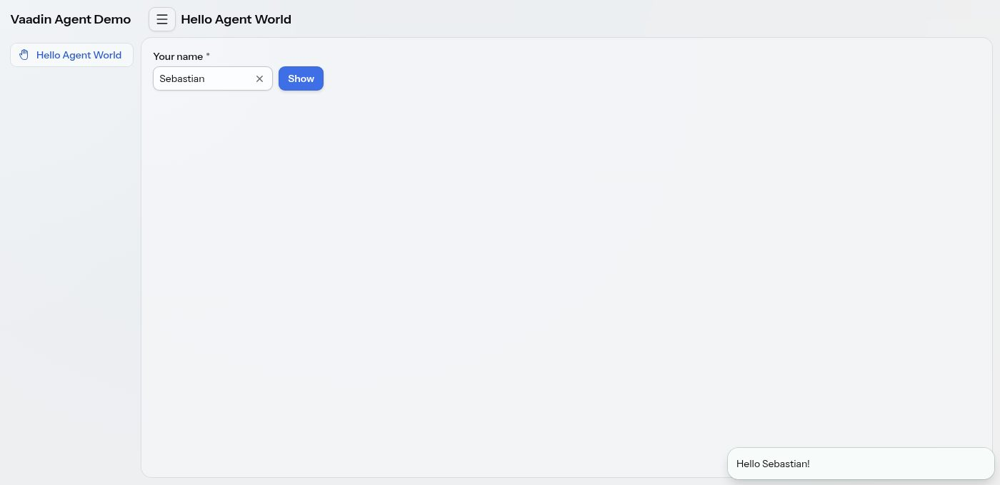
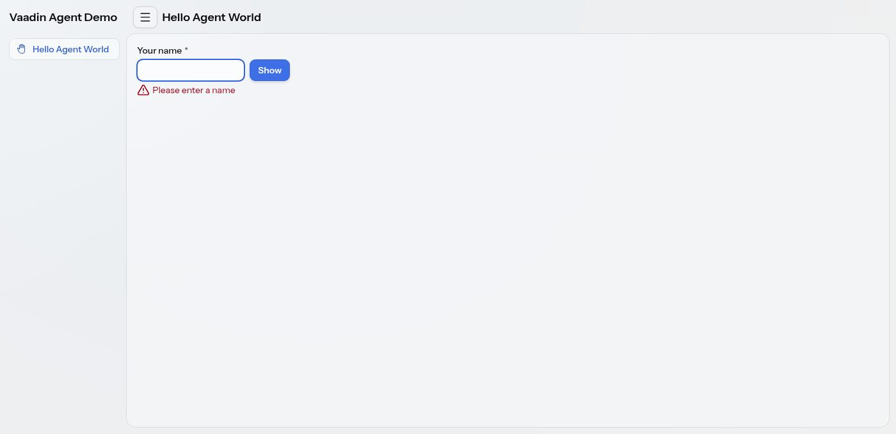
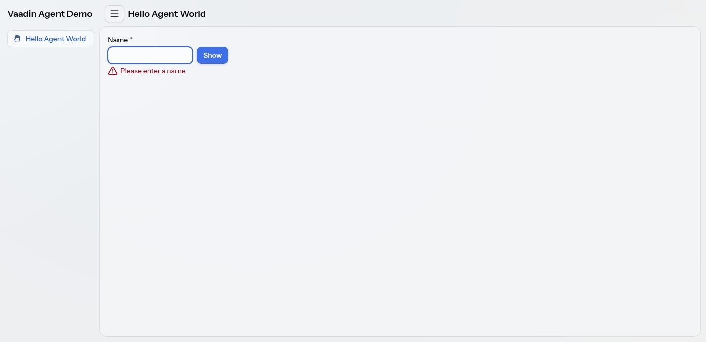
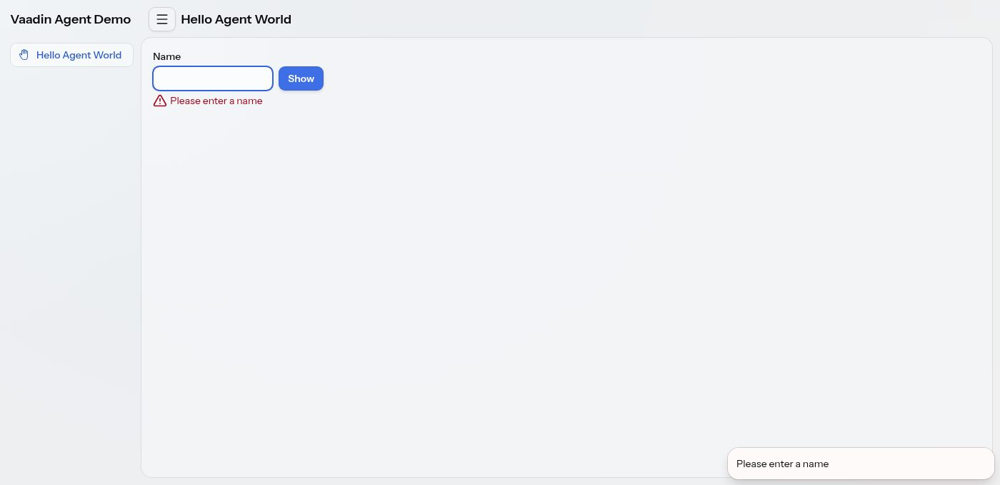
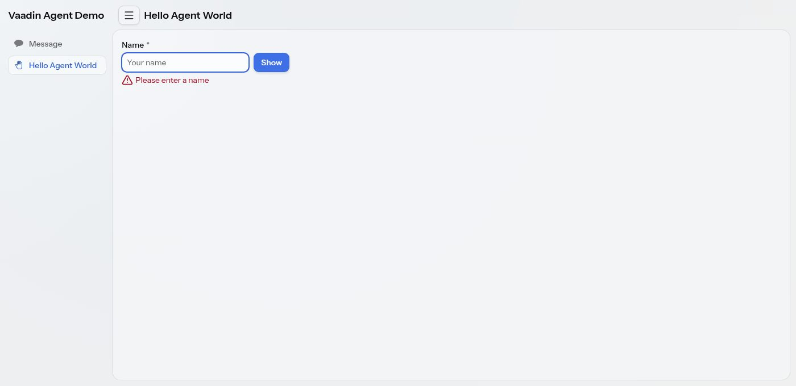
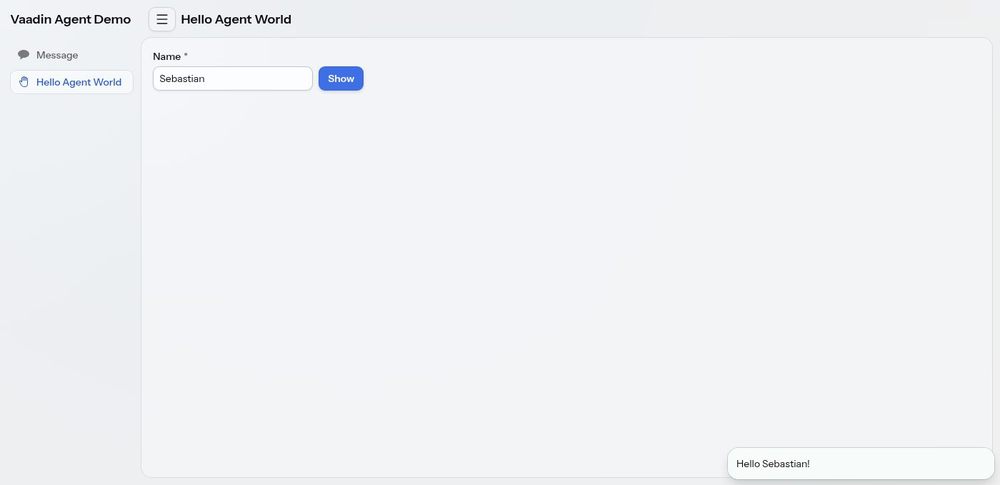

# Quality of the generated code

Companion to the cost table in the [README](README.md). Same 18 runs (6 branches × 3), evaluated after the fact by scripts the agents never saw. Every number below can be reproduced with `quality/evaluate.py`, `quality/gallery.py` and `quality/report.py`; each run's unedited output is in `quality/runs/<branch>/run-<n>.patch`.

## Summary

| Check | `02-vanilla` | `03-MCP` | `04-skills` | `05-tools-hooks` | `06-custom-skills` | `08-devloop` |
| --- | :---: | :---: | :---: | :---: | :---: | :---: |
| All 9 prompt requirements met | ✅ 3/3 | ✅ 3/3 | ✅ 3/3 | ✅ 3/3 | ✅ 3/3 | ✅ 3/3 |
| Both extras (not asked for) | ✅ 3/3 | ✅ 3/3 | ✅ 3/3 | ✅ 3/3 | ✅ 3/3 | ✅ 3/3 |
| No deprecated API | ❌ 0/3 | ✅ 3/3 | ✅ 3/3 | ✅ 3/3 | ✅ 3/3 | ✅ 3/3 |
| Aura only, no theme findings | ✅ 3/3 | ✅ 3/3 | ✅ 3/3 | ✅ 3/3 | ✅ 3/3 | ✅ 3/3 |
| No workarounds (inline style, JS, raw element, string sizes) | ✅ 3/3 | ✅ 3/3 | ✅ 3/3 | ✅ 3/3 | ✅ 3/3 | ✅ 3/3 |
| `MainLayout` left untouched | ✅ 3/3 | ✅ 3/3 | ✅ 3/3 | ✅ 3/3 | ✅ 3/3 | ✅ 3/3 |

✅ all three runs · ⚠️ some runs · ❌ no run

## 1. Acceptance: does the view do what the prompt asks?

`quality/acceptance/HelloAgentWorldAcceptanceTest.java` is a browserless test written independently of the agents. It is copied into each run's tree and finds the view by name, so it does not depend on the package, route or field names the agent chose. Before use it was checked against seven deliberately broken variants of a view (no `@Menu`, no `!`, no success variant, no primary, wrong position, no empty check, no invalid flag); each one made exactly the matching checks fail.

| Requirement | `02-vanilla` | `03-MCP` | `04-skills` | `05-tools-hooks` | `06-custom-skills` | `08-devloop` |
| --- | :---: | :---: | :---: | :---: | :---: | :---: |
| View `HelloAgentWorld…` with `@Route` | ✅ 3/3 | ✅ 3/3 | ✅ 3/3 | ✅ 3/3 | ✅ 3/3 | ✅ 3/3 |
| Entry in the rendered side navigation | ✅ 3/3 | ✅ 3/3 | ✅ 3/3 | ✅ 3/3 | ✅ 3/3 | ✅ 3/3 |
| One text field and a *Show* button | ✅ 3/3 | ✅ 3/3 | ✅ 3/3 | ✅ 3/3 | ✅ 3/3 | ✅ 3/3 |
| Button is primary | ✅ 3/3 | ✅ 3/3 | ✅ 3/3 | ✅ 3/3 | ✅ 3/3 | ✅ 3/3 |
| Notification text is exactly `Hello Sebastian!` | ✅ 3/3 | ✅ 3/3 | ✅ 3/3 | ✅ 3/3 | ✅ 3/3 | ✅ 3/3 |
| Notification uses the success variant | ✅ 3/3 | ✅ 3/3 | ✅ 3/3 | ✅ 3/3 | ✅ 3/3 | ✅ 3/3 |
| Notification at `BOTTOM_END` | ✅ 3/3 | ✅ 3/3 | ✅ 3/3 | ✅ 3/3 | ✅ 3/3 | ✅ 3/3 |
| Empty input: no greeting | ✅ 3/3 | ✅ 3/3 | ✅ 3/3 | ✅ 3/3 | ✅ 3/3 | ✅ 3/3 |
| Empty input: visible feedback (field invalid or error notification) | ✅ 3/3 | ✅ 3/3 | ✅ 3/3 | ✅ 3/3 | ✅ 3/3 | ✅ 3/3 |
| Whitespace-only input: no greeting *(extra)* | ✅ 3/3 | ✅ 3/3 | ✅ 3/3 | ✅ 3/3 | ✅ 3/3 | ✅ 3/3 |
| Name is trimmed (`  Sebastian  ` → `Hello Sebastian!`) *(extra)* | ✅ 3/3 | ✅ 3/3 | ✅ 3/3 | ✅ 3/3 | ✅ 3/3 | ✅ 3/3 |

No check failed in any of the 18 runs.

## 2. Vaadin API and theme

Deprecations come from `javac` (`./mvnw clean test-compile`, deprecation warnings are on in this pom), limited to files the agent wrote. Theme checks are the `vaadin-agent-tools` CLI (0.3.2) run as an outside linter on every branch, whether or not the branch uses the plugin. Workaround patterns are matched on the lines the agent added.

| Check | `02-vanilla` | `03-MCP` | `04-skills` | `05-tools-hooks` | `06-custom-skills` | `08-devloop` |
| --- | :---: | :---: | :---: | :---: | :---: | :---: |
| Deprecated API in agent code (javac) | ❌ 6 / 6 / 6 | ✅ 0 | ✅ 0 | ✅ 0 | ✅ 0 | ✅ 0 |
| `vaadin-agent-tools` `check-aura-usage` / `check-theme-mixing` | ✅ 3/3 | ✅ 3/3 | ✅ 3/3 | ✅ 3/3 | ✅ 3/3 | ✅ 3/3 |
| Lumo API or `--lumo-*` tokens | ✅ 0 | ✅ 0 | ✅ 0 | ✅ 0 | ✅ 0 | ✅ 0 |
| `getStyle().set(…)` | ✅ 0 | ✅ 0 | ✅ 0 | ✅ 0 | ✅ 0 | ✅ 0 |
| `executeJs` / `callJsFunction` | ✅ 0 | ✅ 0 | ✅ 0 | ✅ 0 | ✅ 0 | ✅ 0 |
| `getElement().setProperty/setAttribute/…` | ✅ 0 | ✅ 0 | ✅ 0 | ✅ 0 | ✅ 0 | ✅ 0 |
| Sizes as strings (`setWidth("16em")`) | ✅ 0 | ✅ 0 | ✅ 0 | ✅ 0 | ✅ 0 | ✅ 0 |

Counts per run (run 1 / 2 / 3) where a check found something.

Deprecated API found:

- `02-vanilla` (run-1, run-2, run-3): `<T>$(java.lang.Class<T>)` in the test class — **marked for removal**
- `02-vanilla` (run-1, run-2): `<T>$view(java.lang.Class<T>)` in the test class — **marked for removal**

## 3. How the solutions differ

Not graded — the prompt leaves these open. Taken from the view class of each run.

| Branch | Run | Route | Layout | Enter submits | Required indicator | Error notification | View LOC |
| --- | --- | --- | --- | :---: | :---: | :---: | ---: |
| `02-vanilla` | 1 | `/hello-agent-world` | `HorizontalLayout` | yes | — | — | 46 |
| `02-vanilla` | 2 | `/hello-agent-world` | `HorizontalLayout` | yes | — | — | 49 |
| `02-vanilla` | 3 | `/hello-agent-world` | `HorizontalLayout` | yes | — | — | 47 |
| `03-MCP` | 1 | `/hello-agent-world` | `HorizontalLayout` | yes | yes | — | 47 |
| `03-MCP` | 2 | `/hello-agent-world` | `HorizontalLayout` | yes | yes | — | 49 |
| `03-MCP` | 3 | `/hello-agent-world` | `HorizontalLayout` | yes | — | yes | 50 |
| `04-skills` | 1 | `/hello-agent-world` | `VerticalLayout` | yes | yes | — | 47 |
| `04-skills` | 2 | `/hello-agent-world` | `HorizontalLayout` | yes | yes | — | 46 |
| `04-skills` | 3 | `/hello` | `HorizontalLayout` | yes | yes | — | 47 |
| `05-tools-hooks` | 1 | `/hello-agent-world` | `HorizontalLayout` | yes | yes | — | 51 |
| `05-tools-hooks` | 2 | `/hello-agent-world` | `HorizontalLayout` | yes | — | — | 44 |
| `05-tools-hooks` | 3 | `/hello-agent-world` | `HorizontalLayout` | yes | — | — | 46 |
| `06-custom-skills` | 1 | `/hello-agent-world` | `VerticalLayout` | — | yes | — | 66 |
| `06-custom-skills` | 2 | `/hello-agent-world` | `VerticalLayout` | — | yes | — | 65 |
| `06-custom-skills` | 3 | `/hello-agent-world` | `VerticalLayout` | — | yes | — | 67 |
| `08-devloop` | 1 | `/hello-agent-world` | `VerticalLayout` | — | yes | — | 66 |
| `08-devloop` | 2 | `/hello-agent-world` | `VerticalLayout` | — | yes | — | 66 |
| `08-devloop` | 3 | `/hello-agent-world` | `VerticalLayout` | — | yes | — | 66 |

## 4. Screenshot gallery

Every run, same interaction, headless Chromium at 1400×680 with the dev tools turned off. Left: name `Sebastian` entered and *Show* clicked. Right: *Show* clicked with an empty field. `06` and `08` also list *Message* in the navigation because they started with the reference view.

### `02-vanilla`

| Run | Name entered | Empty input |
| --- | --- | --- |
| 1 |  |  |
| 2 |  |  |
| 3 |  |  |

### `03-MCP`

| Run | Name entered | Empty input |
| --- | --- | --- |
| 1 |  |  |
| 2 |  |  |
| 3 |  |  |

### `04-skills`

| Run | Name entered | Empty input |
| --- | --- | --- |
| 1 |  |  |
| 2 |  |  |
| 3 |  |  |

### `05-tools-hooks`

| Run | Name entered | Empty input |
| --- | --- | --- |
| 1 |  |  |
| 2 |  |  |
| 3 |  |  |

### `06-custom-skills`

| Run | Name entered | Empty input |
| --- | --- | --- |
| 1 |  |  |
| 2 |  |  |
| 3 |  |  |

### `08-devloop`

| Run | Name entered | Empty input |
| --- | --- | --- |
| 1 |  |  |
| 2 |  |  |
| 3 |  |  |

