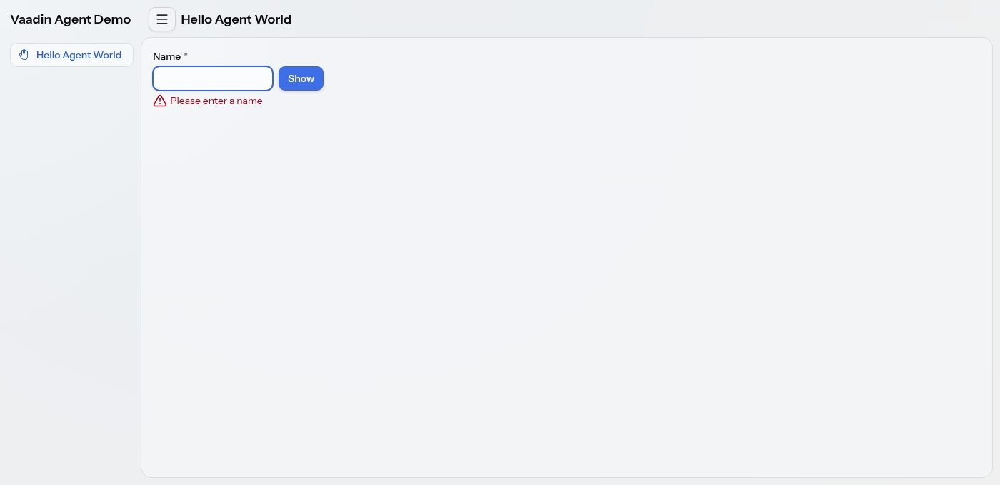
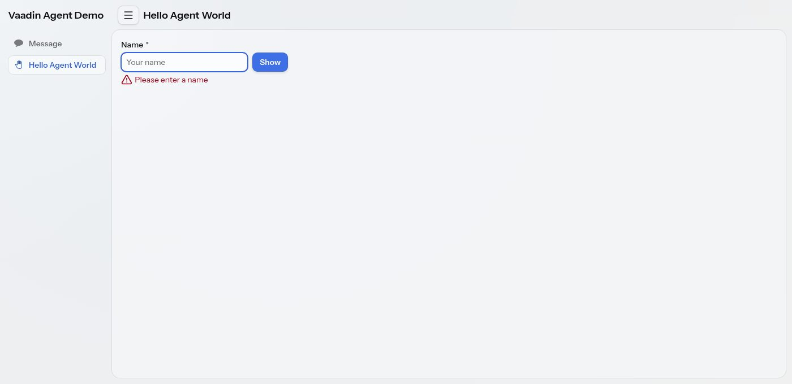

# Vaadin Agent Demo

A Spring Boot + Vaadin 25 project used as a testbed for one question: **how much
does an AI coding agent need to know to build a Vaadin view correctly?**

The same feature request runs once per branch, each time with a different amount of
Vaadin-specific context — docs MCP, skills, hooks, a project-local conventions
skill, the dev loop. Every branch README records what came out and what it cost.
This page is the overview.


*`HelloAgentWorldView` as generated on `08-devloop` (committed run), inside the
shared `MainLayout`. Captured in headless Chromium after clicking **Show**.*

## Run it

```bash
./mvnw spring-boot:run        # Windows: mvnw.cmd spring-boot:run
```

Then open **http://localhost:8080**. `main` has no views of its own — it is the
`baseline` every benchmark branch starts from, so `/` shows Vaadin's "No views
found" page. Check out a branch to see a generated view.

---

## The benchmark prompt

Every measured branch got the same request, verbatim:

> Create a new view names HelloAgentWorld with a text field for a name and a show
> button. On click, a notification with the content of the field with the Prefix
> "Hello" and the suffix "!" should appear. The button should be primary, and the
> notification should be a success message in the bottom right. Empty input should
> be handled. Add the view to the navigation and write a test for it.

---

## Your options for agentic Vaadin development

Check out a branch to get exactly that setup — the configuration is committed, so
nothing touches your personal `~/.claude/settings.json`.

| Branch | What it adds | Reach for it when |
| --- | --- | --- |
| `01-chat-client` | claude.ai in the browser, code pasted into the project by hand | Nothing to install. Not measured here — the chat UI cannot be automated. |
| `02-vanilla` | Claude Code in the terminal, both Vaadin plugins off, no MCP server | You want the baseline: file access, Maven and tests, no Vaadin context. |
| `03-MCP` | The **Vaadin docs MCP server** (`https://mcp.vaadin.com/docs`) via `.mcp.json` | The agent should look up current Vaadin API instead of reading jars. |
| `04-skills` | The **`vaadin-skills` plugin** — Vaadin skills plus the bundled docs MCP server | You want Vaadin's own guidance on testing, theming and forms available as skills. |
| `05-tools-hooks` | **`vaadin-agent-tools`**, three project **hooks** (project facts, Aura/Lumo check, test gate) and a permissions allowlist | A rule has to be enforced on every turn, not only when the agent decides to follow it. |
| `06-custom-skills` | A **project-local skill**, `.claude/skills/vaadin-view-conventions/SKILL.md`, with a reference view | Your codebase has conventions of its own that should be versioned with the code. |
| `07-figma`\* | The **`figma` plugin** plus a project `figma-to-vaadin` skill | The design already exists in Figma. |
| `08-devloop` | The **Vaadin dev loop** (`.vaadin/vaadin-dev` + `vaadin-devloop` skill) on top of `06` | The agent should verify its edits in the running app with hot-swap instead of restarts. |

\* `07-figma` ran a different task (a customer management screen from a Figma file)
and does not run in the Docker sandbox. **It is not comparable** and not part of the
table below. `baseline` is the shared starting point of all measured branches.

## What it cost

Median of three runs per branch, range in brackets. Tests = tests the agent wrote
for the new view.

| Branch | Wall-clock | Cost | Tokens | Tests | Key calls (per run) |
| --- | --- | --- | --- | --- | --- |
| `02-vanilla` | **39s** (37s–42s) ⚡ | **0.28 $** (0.26–0.30) 💰 | 175k (161k–211k) | 7 (7–7) | no MCP, no skill · 2–4 jar lookups (`unzip`/`javap`) |
| `03-MCP` | 42s (37s–47s) | 0.35 $ (0.28–0.42) | 248k (171k–298k) | 5 (5–6) | MCP 2–5 |
| `04-skills` | 1m 04s (1m 02s–1m 26s) | 0.49 $ (0.48–0.55) | 482k (400k–538k) | 6 (6–7) | MCP 4–5 · Skill `vaadin-browserless-testing` ×1 |
| `05-tools-hooks` | 56s (51s–58s) | 0.39 $ (0.38–0.40) | 308k (295k–324k) | 4 (4–5) | MCP 0–4 · Skill `vaadin-browserless-testing` ×1 · hooks 7–10 |
| `06-custom-skills`† | 1m 07s (1m 02s–1m 15s) | 0.53 $ (0.37–0.54) | 595k (325k–672k) | 7 (7–7) | MCP 0–2 · Skill `vaadin-view-conventions` ×1 · app started 3/3 |
| `08-devloop`† | 56s (49s–1m 19s) | 0.36 $ (0.34–0.37) | 322k (319k–364k) | 7 (7–7) | MCP 0 · Skills `vaadin-view-conventions` + `vaadin-devloop` · app started 3/3 |

⚡ fastest · 💰 cheapest · † started with `MessageView` as reference view (see methodology).
All 18 runs ended with `./mvnw clean verify` green, checked outside the agent.
Tokens = input + output + cache read + cache write.

**What the data shows**

- **More context did not make this task cheaper or faster.** `02-vanilla` had the
  lowest median wall-clock and cost of all branches, and every branch — with
  or without Vaadin context — produced a green build, `@Menu` navigation and the
  theme-agnostic `ButtonVariant.PRIMARY` / `NotificationVariant.SUCCESS`.
- **The MCP server replaced jar spelunking, not cost.** `02-vanilla` read the API out
  of `~/.m2` with `unzip`/`javap` (2–4 calls per run); `03-MCP` never did, but paid
  0.35 $ instead of 0.28 $ in the median, and its cost rose with the number of MCP
  lookups (2 → 0.28 $, 4 → 0.35 $, 5 → 0.42 $).
- **Of the plugin skills, only one was ever used.** `04-skills` and `05-tools-hooks`
  invoked `vaadin-browserless-testing` once per run and nothing else; in `04` it
  produced a page-object test helper every time.
- **Hooks fired, but never had to intervene.** In `05`/`06`/`08` the project hooks
  ran on every `Bash` call and at `Stop` and never blocked. The `vaadin-agent-tools`
  hook (matcher `Edit|Write|MultiEdit`) fired in only one of nine runs, because the
  agent wrote almost all files through `Bash` heredocs.
- **Only the conventions skill led the agent to start the app.** `02`–`05` stopped
  at `./mvnw test` in all twelve runs; `06` and `08` started the app and checked it in
  a headless browser in all six. They also produced the most uniform output — same
  package, 7 tests every run — but started from a reference view.
- **The dev loop made the app check cheaper.** With the same visual check, `08` cost
  0.36 $ against 0.53 $ on `06` and was faster in the median (56s vs. 1m 07s). The
  agent invoked the `vaadin-devloop` skill in every run without the prompt asking
  for it.
- **Test count does not follow context.** `05-tools-hooks` wrote the fewest tests
  (4–5), `02-vanilla` as many as `06`/`08` (7).

> **Methodology.** Claude Opus 5.5 (`claude-opus-5-5`), Claude Code 2.1.331, three
> runs per branch, measured 2026-11-24 on Vaadin 25.3.6 / Spring Boot 4.2.0. Each run
> was a new `claude -p` session in a fresh clone of the branch's setup commit, with
> `--setting-sources project`, `--permission-mode bypassPermissions` and
> `ENABLE_CLAUDEAI_MCP_SERVERS=false` (no user settings, plugins or connectors leaking
> in; verified in each run's `init` message). Costs, times and tokens come from the
> run's `result` message; raw streams are in each branch's `runs/`. The committed code
> is the run with the median cost.
> **`06-custom-skills` and `08-devloop` started with `MessageView` + its 5 tests**,
> because their conventions skill names it as the reference view; all other branches
> started without any view. Those two branches therefore had a different starting
> point. The full record of deviations is in [`REFRESH-REPORT.md`](REFRESH-REPORT.md).

## How good is the code?

All 18 runs were checked afterwards by scripts the agents never saw: an independent
acceptance test for the nine requirements of the prompt, the `javac` deprecation
warnings, the `vaadin-agent-tools` theme linter and a scan for Vaadin workarounds.
Details, per-run tables and the full screenshot gallery: **[`QUALITY.md`](QUALITY.md)**.

| Check (runs out of 3) | `02` | `03` | `04` | `05` | `06`† | `08`† |
| --- | :---: | :---: | :---: | :---: | :---: | :---: |
| All 9 prompt requirements met | ✅ 3 | ✅ 3 | ✅ 3 | ✅ 3 | ✅ 3 | ✅ 3 |
| No deprecated API | ❌ 0 | ✅ 3 | ✅ 3 | ✅ 3 | ✅ 3 | ✅ 3 |
| Aura only, no theme findings | ✅ 3 | ✅ 3 | ✅ 3 | ✅ 3 | ✅ 3 | ✅ 3 |
| No workarounds (inline style, JS, raw element) | ✅ 3 | ✅ 3 | ✅ 3 | ✅ 3 | ✅ 3 | ✅ 3 |
| Required indicator on the field *(not asked for)* | 0 | 2 | 3 | 1 | 3 | 3 |
| Enter submits *(not asked for)* | 3 | 3 | 3 | 3 | 0 | 0 |

- **Functionally, every branch got it right.** All 18 runs pass all nine acceptance
  checks, plus trimming and whitespace-only input, which the prompt did not ask for.
  The acceptance test was validated first against seven deliberately broken views.
- **The one real defect is deprecated API on `02-vanilla`.** Its tests use the
  browserless `$(…)` / `$view(…)` lookups, which are deprecated and marked for
  removal — in all three runs. It is the only branch without access to the Vaadin docs;
  its API came from the jars in `~/.m2`.
- **Theme and API hygiene are clean everywhere.** No Lumo API, no `--lumo-*` tokens,
  no inline styles, no `executeJs`, no string sizes, in any run.
- **The rest are UX details the prompt leaves open.** `06` and `08` follow their
  reference view: required indicator, no Enter shortcut (`MessageView` has none).
  `02`–`05` added an Enter shortcut in every run.

Empty input in the committed run of each branch:

| `02-vanilla` | `03-MCP` | `04-skills` |
| --- | --- | --- |
|  |  |  |
| **`05-tools-hooks`** | **`06-custom-skills`** | **`08-devloop`** |
|  |  |  |

---

## Learn more

- [Vaadin Quickstart](https://vaadin.com/quickstart) — the 5-minute getting-started path
- [Components](https://vaadin.com/docs/latest/components) — 50+ UI components, all callable from Java
- [Vaadin MCP setup](https://vaadin.com/docs/latest/building-apps/mcp) — wire the docs server into your assistant
- [Dev Loop CLI](https://vaadin.com/docs/latest/flow/configuration/live-reload/dev-loop-cli) — hot-swap and verify edits in the running app
- [Full documentation](https://vaadin.com/docs)
